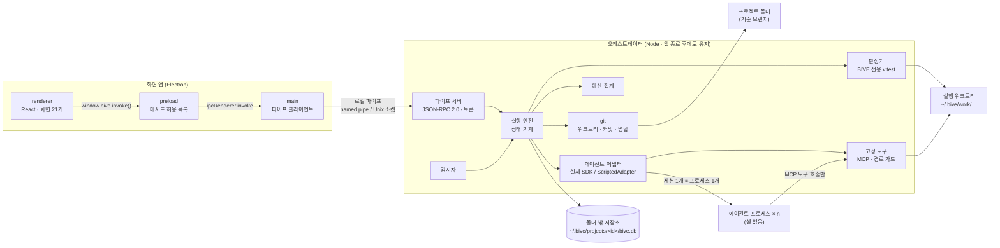
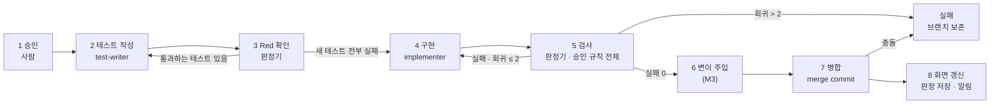
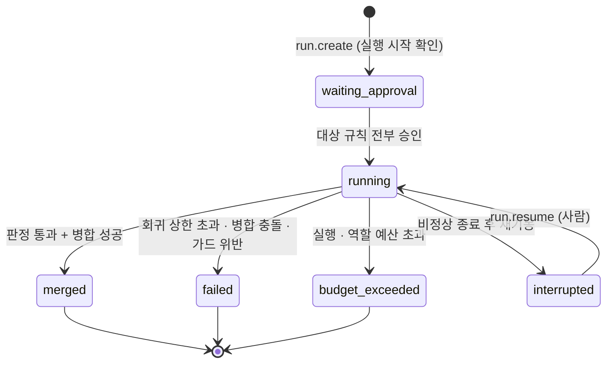
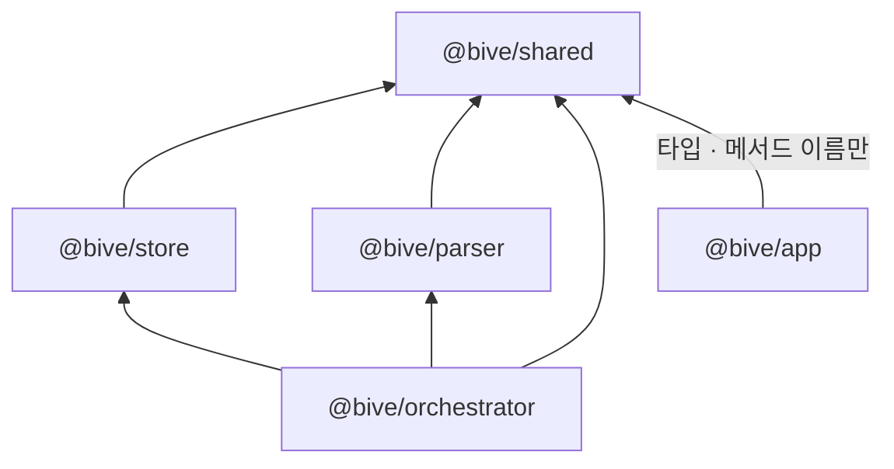

# BIVE

**Baseline-Integrated Verification Environment** — 에이전트가 짠 코드를 사람이 읽지 않고도 검증하는 로컬 데스크톱 앱.

사람은 요구사항을 문장으로 적고, 에이전트가 제안한 규칙을 승인하고, 실행을 확인하는 세 가지만 한다. 테스트 작성 → Red 확인 → 구현 → 검사 → 병합은 고정 파이프라인이 사람 개입 없이 끝내고, 판정은 에이전트의 말이 아니라 **인수 테스트의 실행 결과**로만 내린다.

> 상태: M0(기반) 진행 중 · 기준 문서 PRD v0.9 (`docs/spec/prd.md`) · 2026-10-15

## 목차

1. [BIVE는 무엇인가](#1-bive는-무엇인가)
2. [전체 구조](#2-전체-구조)
3. [실행 파이프라인](#3-실행-파이프라인)
4. [저장소 구조](#4-저장소-구조)
5. [시작하기](#5-시작하기)
6. [개발 규칙](#6-개발-규칙)
7. [문서](#7-문서)
8. [로드맵](#8-로드맵)

## 1. BIVE는 무엇인가

에이전트 코딩이 퍼지면서 **코드가 생산되는 속도가 사람이 검토하는 속도를 넘어섰다**. 그런데 검증은 여전히 사람이 코드를 읽는 방식에 기대고 있다. BIVE는 검증의 기준을 "사람이 읽었는가"에서 "규칙을 실행으로 증명했는가"로 옮긴다.


설계 전체를 관통하는 비기능 원칙 세 가지:

| 원칙 | 내용 | PRD |
|---|---|---|
| 무결성 | 요구사항 · 규칙 · 승인 기록은 프로젝트 폴더 **밖**(`~/.bive/`)의 SQLite에 두고, 에이전트는 접근할 수 없다. 승인 기록은 해시 체인으로 추가만 된다. | NFR-01 |
| 역할 접근 제한 | 에이전트 세션에 셸이 없다. BIVE가 제공하는 고정 도구(MCP)만 쓰고, 역할별 경로 가드 안에서만 파일을 만진다. | NFR-02 |
| 데이터 출처 | 화면에 보이는 모든 값은 파서 또는 실행 결과에서만 만든다. 에이전트의 "통과했습니다"라는 메시지는 상태 변경 입력이 아니다. | NFR-03 · JDG-01 |

서버 · 계정 없이 로컬에서만 돈다. Windows를 최우선으로 macOS · Linux에서 같은 동작을 목표로 한다 (NFR-04 · NFR-10).

## 2. 전체 구조

프로세스 3층으로 나뉜다. 화면 앱(Electron)은 보여주기만 하고, 실제 일은 백그라운드 **오케스트레이터**가 한다. 오케스트레이터는 앱을 닫아도 진행 중인 실행이 끝날 때까지 살아 있고, 에이전트 프로세스는 세션마다 하나씩 띄운다.



| 층 | 역할 | 비고 |
|---|---|---|
| 화면 앱 | 21개 화면(SCR-01~21) 렌더링, 폴더 선택 대화상자, 오케스트레이터 기동 | 렌더러는 Node 모듈 · `require` 없음. `window.bive`는 `invoke` · `on` 두 메서드만 노출 |
| 오케스트레이터 | 파이프 서버, 실행 상태 기계, 판정, 예산, git, 에이전트 세션 관리 | 사용자당 1개. 진행 중 실행 없음 + 연결된 앱 없음이면 자동 종료 |
| 에이전트 프로세스 | Claude Agent SDK 세션. 역할(rule-writer · test-writer · implementer …)별로 모델 · 예산 · 도구 목록이 다름 | TCP 포트 없음. 저장소(`~/.bive/projects`) 접근 불가 |

통신은 로컬 파이프 위의 **JSON-RPC 2.0** 한 줄 프레임이다. 모든 요청 · 응답 · 알림은 `packages/shared`의 zod 스키마로 양쪽에서 검증하고, 연결은 기동마다 갱신되는 토큰(`~/.bive/run/token`, 0600)으로 연다. 상세는 [`docs/architecture.md`](docs/architecture.md) 5장.

## 3. 실행 파이프라인

실행(Run)은 승인된 규칙을 대상으로 만들어지고, 유형 A(신규 동작) 기준으로 8단계를 순서대로 지난다. 검사에 실패하면 구현으로 되돌아가되, **회귀는 최대 2회**(구현 단계 최대 3회)다.



| 단계 | 주체 | 종료 조건 |
|---|---|---|
| 테스트 작성 | test-writer 세션 | 대상 규칙마다 인수 테스트 파일 1개 이상, 허용 import · 허용 경로만 |
| Red 확인 | 판정기 | 새 테스트 케이스가 전부 실행되고 전부 실패 (구현 전에 통과하는 테스트는 무효) |
| 구현 | implementer 세션 | 세션 종료 후 판정기가 대상 규칙 테스트를 실행해 전부 통과 |
| 검사 | 판정기 | 승인된 규칙 전체의 인수 테스트 실패 0. Red 확인 때 기록한 테스트 파일 해시와 대조해 바뀌었으면 즉시 실패 |
| 병합 | 오케스트레이터 | 기준 브랜치에 `--no-ff` merge commit. 기준 브랜치가 그사이 바뀌었으면 임시 워크트리에서 검사를 다시 돌린 뒤에만 갱신 |

커밋과 병합은 오케스트레이터만 한다. 에이전트에게는 git 도구가 없다 (RUN-08).

실행 상태는 단계 종료마다 트랜잭션 1회로 저장한다. 오케스트레이터가 비정상 종료되면 재기동 시 `running`을 `interrupted`로 바꾸고, 사람이 재개하면 마지막 완료 단계 커밋으로 워크트리를 되돌린 뒤 다음 단계부터 새 세션으로 이어 간다.



예산은 세션마다 `maxBudgetUsd = min(역할 잔여, 실행 잔여)`로 넘긴다. 초과하면 세션을 끊고 실행은 `budget_exceeded`로 끝나며 병합하지 않는다 (COST-01).

## 4. 저장소 구조

pnpm 워크스페이스 · TypeScript strict · ESM. 패키지 경계는 ESLint `no-restricted-imports`로 강제하고, 위반 예제마다 오류가 나는지 `packages/shared/test/lint-rules.test.ts`가 확인한다.

```
bive/
├── packages/
│   ├── shared/         도메인 타입 · 상태 enum · IPC 프로토콜 스키마(zod) · ID
│   ├── store/          프로젝트 폴더 밖 저장소 (better-sqlite3, ~/.bive/) · 마이그레이션
│   ├── parser/         import 그래프 · 블록 판정 · ERD · 클론 탐지 · 테스트 경로 스캔 (M4)
│   ├── orchestrator/   파이프 서버 · 실행 엔진 · 에이전트 어댑터 · 고정 도구 · 판정기 · 예산 · git
│   └── app/            Electron main · preload · renderer(React)
├── fixtures/
│   └── sample-next-app/  테스트 대상 프로젝트 (Next.js · Prisma · SQLite · Vitest, M0-08)
├── docs/
│   ├── spec/           prd.md · screens.md · plan.md  (원본, 사람만 수정)
│   ├── architecture.md 패키지 경계 · 데이터 모델 · 상태 기계 · IPC · 테스트 전략
│   ├── decisions.md    ADR (결정은 여기에만 남긴다)
│   ├── roadmap.md      마일스톤 · 이슈 · 수용 기준
│   └── prototype-map.md 프로토타입 → 화면(SCR) → 렌더러 모듈 대응표
├── scripts/            gh-rest.sh (GitHub REST 래퍼) · publish-roadmap.py
├── .claude/skills/     pr-reviewer · publish-roadmap · run-milestone
├── CLAUDE.md           개발 규칙 (운영 방식)
└── eslint.config.js    패키지 경계 · 테스트 전용 모듈 import 금지 규칙
```

의존 방향은 한쪽으로만 흐른다. `app`은 `shared`만 import하고, 오케스트레이터는 실행 파일 경로로만 기동한다 (프로세스 경계를 import로 넘지 않는다).



런타임 데이터는 전부 `BIVE_HOME`(기본 `~/.bive`) 아래에 둔다. 테스트는 임시 디렉터리로 덮어쓴다.

| 경로 | 내용 | 에이전트 접근 |
|---|---|---|
| `~/.bive/run/` | 파이프 경로 · 접속 토큰 · pid 잠금 | 불가 |
| `~/.bive/projects/<projectId>/bive.db` | 규범 · 실행 · 판정 · 승인 기록 | 불가 |
| `~/.bive/projects/<projectId>/judge/<runId>/` | vitest JSON 원본 · 판정기 설정 | 불가 |
| `~/.bive/work/<projectId>/worktrees/<runId>/` | 실행 워크트리 | 역할별 경로 가드 안에서만 |
| `~/.bive/work/<projectId>/sessions/<sessionId>/` | 역할 작업 디렉터리 | 해당 세션만 |

프로젝트 폴더에는 `.bive.json`(`projectId` · `schemaVersion`) 하나만 생긴다.

## 5. 시작하기

요구 사항: Node 22.12 이상, pnpm 10 (`packageManager` 필드로 고정).

```sh
pnpm install --frozen-lockfile   # 의존성 설치 (better-sqlite3 · electron · esbuild 빌드 스크립트 허용됨)
pnpm lint                        # ESLint (패키지 경계 규칙 포함)
pnpm typecheck                   # tsc --noEmit, 패키지별
pnpm test                        # vitest, 패키지별
pnpm build                       # tsc 빌드 → packages/*/dist
pnpm format:check                # Prettier
```

M0 나머지 이슈에서 추가되는 명령:

| 명령 | 내용 | 이슈 |
|---|---|---|
| `pnpm e2e` | Playwright로 Vite 개발 서버 렌더러를 열고 화면 체크리스트 검사 · 스크린샷 | M0-07 |
| `xvfb-run -a pnpm smoke` | Electron 기동 · preload 노출 · 오케스트레이터 연결 표시 확인 | M0-06 |
| `pnpm --filter @bive/orchestrator start` | 오케스트레이터 단독 기동 (`BIVE_HOME` · `BIVE_IDLE_SHUTDOWN_MS`) | M0-05 |
| `pnpm --filter @bive/app cli ping` | 파이프로 `ping` → `pong` | M0-06 |
| `scripts/reset-fixture.sh <dir>` | 픽스처 프로젝트를 복사해 git 저장소로 초기화 | M0-08 |

헤드리스 환경 메모: GUI가 없는 VM에서는 `xvfb-run -a`로 Electron 창을 띄우고, root로 실행하면 `--no-sandbox`가 필요하다. 모든 자동 테스트는 실제 Claude API 없이 **ScriptedAdapter**(시나리오 파일로 턴을 재생하는 가짜 에이전트, `BIVE_AGENT=scripted`)로 돈다. 실제 SDK 완주는 사람이 확인한다.

## 6. 개발 규칙

상세는 [`CLAUDE.md`](CLAUDE.md). 요약:

- **문서 우선순위**: 내용이 다르면 PRD > 화면 정의서 > 기획서. 요구사항은 PRD ID(`RUN-08` `NFR-01` …), 화면은 `SCR-01`~`SCR-21`로 부른다.
- **결정은 ADR로만**: `docs/decisions.md`에 맥락 · 결정 · 결과를 남긴다. `docs/spec/*` 원본은 사람만 고친다.
- **이슈 1개 = 브랜치 1개 = PR 1개**: 브랜치 `feat/<이슈번호>-<slug>` (`fix/` `chore/` `docs/`), PR 본문 첫 줄 `Closes #<번호>`, squash 머지.
- **커밋**: `type(scope): 요약 (#이슈)`. type = feat · fix · chore · docs · test · refactor.
- **머지 조건**: CI `ci` 통과 + `pr-reviewer` 스킬 검토.
- **언어**: 문서 · 이슈 · PR · UI 문구 · 주석은 한국어, 식별자 · 파일명은 영어. UI 문구는 명사형, 이모지 · 코드 표기 금지.
- **목 데이터 금지**: 화면 데이터는 파서 · 실행 결과에서만. 목은 테스트 코드 안에서만 (NFR-03).
- **테스트를 끄거나 건너뛰어 통과시키지 않는다.** 임시 우회는 ADR 없이는 금지.

## 7. 문서

| 문서 | 내용 |
|---|---|
| [`docs/spec/prd.md`](docs/spec/prd.md) | 요구사항 (PRJ · NRM · RUN · JDG · DSN · TODO · COST · MET · COL · NFR). 가장 최신 원본 |
| [`docs/spec/screens.md`](docs/spec/screens.md) | 화면 정의서 SCR-01~21. 1.1 UI 문구 원칙, 1.3 요구사항 매핑 |
| [`docs/spec/plan.md`](docs/spec/plan.md) | 기획서. 용어(3장) · 동작 상세 |
| [`docs/architecture.md`](docs/architecture.md) | 3층 구조 · 패키지 경계 · 데이터 모델 · 실행 상태 기계 · IPC 메서드 · 테스트 전략 · 보안 경계 |
| [`docs/decisions.md`](docs/decisions.md) | ADR-001~ (ID 체계, 저장 위치, 가짜 어댑터, 헤드리스 실행 등) |
| [`docs/roadmap.md`](docs/roadmap.md) | 마일스톤 M0~M6, 이슈 키 · 의존 · 수용 기준 · GitHub 이슈 번호 |
| [`docs/roadmap-format.md`](docs/roadmap-format.md) | 로드맵 표 형식 |
| [`docs/prototype-map.md`](docs/prototype-map.md) | 프로토타입 파일 → SCR → 렌더러 모듈 |
| [`docs/needs-human.md`](docs/needs-human.md) | 사람만 할 수 있는 항목 목록 |

## 8. 로드맵

| 마일스톤 | 목표 | PRD 단계 |
|---|---|---|
| M0 기반 | 모노레포 · CI · 3층 뼈대 · 테스트 하네스 · 픽스처 | — |
| M1 첫 슬라이스 | 요구사항 1개 → 규칙 → 승인 → 유형 A 파이프라인 → 판정 → 병합 → 화면 | M1 |
| M2 측정 시작 | 코드 열람 기록 (MET-01) | M1 직후 |
| M3 판정 확장 | 구조 · 계약 검사, 변이 주입, 유형 B · C · D, 검토 대기열 | M2 (1/3) |
| M4 설계 화면 · 수집 | 동기화, 파서, 아키텍처 L0 · L1 · 흐름도 · ERD · 변경 로그 · ADR | M2 (2/3) |
| M5 지시 · 질문 · 추적성 | 채팅, 항목 단위 지시 · 질문, 추적성 맵 | M2 (3/3) |
| M6 확장 | 역추출, 자동 모드, 실행 추적, 의존성, 패키징 · 성능 | M3 |

진행 상황은 GitHub 이슈 [#1](https://github.com/chanrhan/bive/issues/1)에 기록한다.
