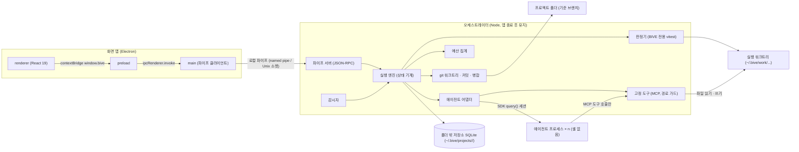
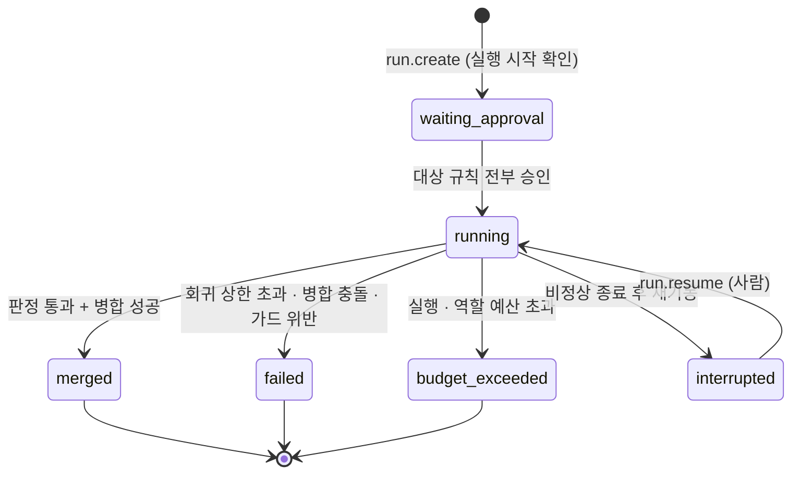

# BIVE 아키텍처

> 상태: 초안 v0.1 · 2026-10-15 · 기준 문서 PRD v0.9 · 화면 정의서 v0.5 · 기획서 · ADR-001~014
> 범위: M1(P0)을 기준으로 쓰고, M2(P1) 확장 지점만 표시. 요구사항은 PRD ID, 화면은 SCR ID로 부른다 (ADR-001).
> 이 문서에서 새로 내린 해석은 11장 "추가 결정 후보"에 모았다. 조율자가 ADR로 옮기기 전까지 상태는 제안.

## 1. 개요

- 제품: 로컬 데스크톱 앱. 서버 · 계정 없음 (NFR-04, PRD 2.2)
- 3층 구성 (PRD 5.1 확정): 화면 앱(Electron) · 오케스트레이터(Node 백그라운드) · 에이전트 프로세스(세션당 1개)
- 통신: 로컬 파이프만. TCP 포트 미개방 (PRD 5.1)
- 규범 · 승인 기록 · 검사 매핑: 프로젝트 폴더 밖 저장소 (NFR-01)
- 에이전트: Claude Agent SDK(TypeScript), 셸 없음 · BIVE 고정 도구만 (NFR-02)
- 지원 OS: Windows 최우선 · macOS · Linux 동일 동작 (NFR-10)



- 오케스트레이터 수명 (PRD 5.1): 앱 실행 또는 실행 시작 시 기동. 진행 중 실행 없음 + 연결된 앱 없음이면 자동 종료(실행 밖 rule-writer 세션이 대기 · 진행 중이어도 미룸, ADR-062). 사용자당 1개, 여러 프로젝트 관리
- 끊김 복구 (PRD 5.1): 재기동 시 `running` 실행을 `interrupted`로 표시. 자동 재개 없음
- 꺼져 있던 동안의 코드 변경: 다음 기동 시 감시자가 마지막 판정 커밋과 기준 브랜치 HEAD 비교 → 영향 규칙 `재검증 필요` (PRD 5.1, JDG-02)

## 2. 패키지 경계와 의존 방향

pnpm 워크스페이스 · TypeScript strict · ESM. 경계는 ESLint `no-restricted-imports`로 강제 (M0).

| 패키지 | 역할 | import 허용 | import 금지 |
|---|---|---|---|
| `packages/shared` | 도메인 타입 · 상태 enum · IPC 프로토콜 zod 스키마 · ID 생성 | `zod`, `ulid` | 다른 워크스페이스 패키지 전부, Node 전용 모듈 |
| `packages/store` | 폴더 밖 저장소. better-sqlite3 · 마이그레이션 · 리포지토리 | `shared`, `better-sqlite3` | `orchestrator`, `parser`, `app` |
| `packages/parser` (M2) | import 그래프 · 블록 판정 · Prisma→ERD · jscpd · 테스트 요청 경로 스캔 · OpenAPI 대조 | `shared` | `store`, `orchestrator`, `app` (순수 함수: 파일 입력 → 결과) |
| `packages/orchestrator` | 파이프 서버 · 실행 엔진 · 에이전트 어댑터 · 고정 도구 · 판정기 · 예산 · git · 감시자 | `shared`, `store`, `parser`, `@anthropic-ai/claude-agent-sdk` | `app` |
| `packages/app` main | 창 · 파이프 클라이언트 · 오케스트레이터 기동 · 폴더 선택 대화상자 | `shared`, `electron` | `store`, `orchestrator`, `parser` (프로세스 경계 넘는 import 금지, 실행 파일 경로로만 기동) |
| `packages/app` preload | `window.bive` 노출(`invoke` · `on`만). 메서드 허용 목록은 main (ADR-042) | `electron`, `shared` (타입만) | Node 모듈 직접 노출 |
| `packages/app` renderer | 화면 21개 (SCR-01~21) | `shared` (`import type`만), `react` | `electron`, Node 모듈, 다른 패키지 런타임 코드 |
| `fixtures/sample-next-app` | 테스트 대상 프로젝트 (Next.js · Prisma · SQLite · Vitest, PRD 6장) | 자체 의존성만 | 워크스페이스 패키지 전부 |

- 의존 방향: `shared` ← `store` · `parser` ← `orchestrator`. `app`은 `shared`만. 순환 금지
- 저장소 접근 주체: 오케스트레이터 프로세스 1개뿐. 앱 · 에이전트는 파이프 · MCP 도구를 거쳐서만 (NFR-01)

에이전트 어댑터 (`orchestrator/src/agents/`)

```ts
interface AgentAdapter {
  startSession(spec: SessionSpec): AgentSession; // role · model · workDir · 도구 목록 · maxTurns · maxBudgetUsd · 프롬프트
}
interface AgentSession {
  turns(): AsyncIterable<AgentEvent>; // init(tools · mcp_servers) · assistant · tool_use · tool_result · result
  cost(): CostReport | null;          // total_cost_usd · num_turns · modelUsage, 값 없으면 null
  abort(reason: AbortReason): Promise<void>;
}
```

- `ClaudeSdkAdapter`: SDK `query()` 1회 = 세션 1개 (기획서 3.2). 세션 옵션은 10장
- `ScriptedAdapter`: 시나리오 파일의 도구 호출 · 파일 변경 · 비용 메시지를 순서대로 재생. 도구 호출은 실제 고정 도구 · 경로 가드를 통과 (가드도 함께 검증). 모든 자동 테스트가 사용 (Claude 인증 없음)
- 실행 엔진은 `AgentEvent`만 소비. 에이전트 텍스트는 이벤트 로그로만 저장, 상태 전이 입력 아님 (JDG-01)
- 규칙 자동 생성 (M1-08, ADR-062): `orchestrator/src/rule-writer/`의 `RuleWriterService`. `requirement.create`가 요구사항을 저장한 같은 저장소 열림에서 `start`를 부르고, 중복 · 설정 검사(`requireRunnableSettings(store, ['rule-writer'])`) 뒤 세션을 대기열(동시 1개)에서 비동기로 돌린다. 설정 미비면 세션 없이 생략 기록 · 로그만 남기고 요구사항 저장은 성공. 세션은 선택된 어댑터 · 설정의 rule-writer 모델 · 한도 · 도구 `propose_rule` 하나 · 세션 가드로 돌고, 제안은 `ProposalService.submit`으로 `pending`만 등록한다. 기록(도구 호출 · 매니페스트 · 결과)은 메모리 `Orchestrator.ruleWriter.records`와 표준 출력 로그뿐이고 저장은 M1-14

패키지 간 import 해석 (M0-03)
- `@bive/shared`의 `exports` 맨 앞에 사용자 정의 조건 `@bive/source` → `./src/index.ts`를 두고, 그 뒤 `types` · `default`는 `dist`를 가리킨다. store · parser가 import 대상이 되면 같은 조건을 추가한다 (store는 M0-04에서 추가)
- 타입 검사: `tsconfig.base.json`의 `customConditions: ["@bive/source"]`로 src를 읽는다. 단위 테스트: 각 패키지 `vitest.config.ts`의 `ssr.resolve.conditions`에 같은 조건을 넣는다. 따라서 `pnpm typecheck` · `pnpm test`는 빌드 없이 통과한다
- 빌드: 각 `tsconfig.build.json`이 `customConditions: []`로 덮어써 `dist`의 선언 파일을 쓴다 (`pnpm -r build`가 의존 순서대로 빌드). Node · Electron 런타임은 이 조건을 모르므로 항상 `dist`를 읽는다
- 증명: `packages/store/test/shared-import.test.ts`

## 3. 데이터 모델

공통 규칙
- PK: ULID 문자열. 화면 표시용 `displayId`는 프로젝트별 순번 (`REQ-001` `RULE-001` `CON-001` `EXE-001` `PRP-001` `ADR-001`). `PRP-xxx`는 SCR-20 근거, 나머지 접두사는 11장 후보
- `author`: `{ kind: 'human' } | { kind: 'agent', role }` (NRM-01, NFR-03, ADR-008). role = `rule-writer` · `planner` · `test-writer` · `implementer` · `chat` (ADR-009)
- 시각: ISO 8601 UTC 문자열. 비용: USD 실수, 값 없으면 `null` → 화면 '없음' (COST-02)
- 규범 상태 `normState`: `approved` · `provisional`. 승인 전 제안은 규범 테이블에 없음 (NRM-04). `provisional`은 정책 '사용 안 함'이라 M1 · M2 기본 미발생 (ADR-012)
- 삭제: 소프트 삭제(`deletedAt`). 이력 보존 (NRM-07)

| 엔터티 | 필드 (타입) | 출처 |
|---|---|---|
| **Project** | `id`, `name`, `rootPath`, `baseBranch`, `createdAt` | PRJ-01 |
| | 프로젝트 폴더 설정 파일 `.bive.json` = `{ projectId, schemaVersion }`만 | PRJ-01, ADR-005 |
| **Settings** | `projectId`, `run{maxBudgetUsd, maxTurns}` (실행 전체 한도, 미설정 시 실행 거부) | COST-01, NFR-07, 기획서 4.5, ADR-057 |
| | `roles{<역할>: {model, maxBudgetUsd, maxTurns}}` (모든 역할 키, 값 `null` = 미설정. 실행 전 검사 역할은 `settings.validateForRun`이 정함) | NFR-07, ADR-024, ADR-057 |
| | `approvalQueueLimit` (기본 40), `provisionalPolicy` (`off` 기본), `autoMode` (`false`), `installAllowlist` (빈 목록), `updatedAt` · `updatedBy` (사람, 저장 전 `null`) | TODO-04, ADR-012, RUN-05, NFR-02 |
| | `writingRules` (P2), `updatedAt`, `updatedBy` | NRM-10 |
| **Requirement** | `id`, `displayId`, `text`, `author`, `normState`, `createdAt`, `updatedAt`, `updatedBy` (마지막 수정 · 삭제 주체), `deletedAt` | NRM-01, ADR-047 |
| | `unrulable: { reason } \| null` | NRM-08 |
| | 파생: 상태 = 자식 판정 종합, 결함 = 자식 규칙 0개 ∧ `unrulable` 없음 | 기획서 3.1, NRM-06 |
| **Rule** | `id`, `displayId`, `title`, `statement` (EARS), `kind` (`architecture` · `tech-constraint` · `business`) | NRM-02, 기획서 3.1 |
| | `checkKinds[]` (1개 이상: `test` · `pbt` · `contract` · `static` · `structure`) | NRM-02, 기획서 4.2 |
| | `parentRequirementId` (내장 구조 규칙만 `null`), `parentDetachedAt` (부모 요구사항 삭제로 부모가 해제된 시각, 그때 `parentRequirementId = null`), `builtin: boolean` | NRM-02, JDG-05, ADR-050 |
| | `targetBlockIds[]` (1개 이상, P1), `risk` (`low` · `medium` · `high`, P1) | NRM-09 |
| | `contractId?` (`contract` 검사), `author`, `normState`, 시각 | NRM-03, NFR-03 |
| | 파생: `judgment` = 최신 JudgmentResult, `mutation` = 최신 변이 결과 (P1) | JDG-02, JDG-04 |
| **Contract** (P1) | `id`, `displayId`, `kind` (`openapi` · `db-schema` · `asyncapi` · `external-api` · `cache` · `json-schema`), `filePath` (등록 단위 = 파일), `contentHash` | NRM-03, SCR-04 |
| | `parentRequirementId?` (0~1), `author`, `normState` | 기획서 3.1 |
| **Block** (P1) | `id`, `name`, `kind` (`domain` · `shared`), `include[]`, `public[]`, `dependsOn[]`, `risk`, `author` | 기획서 3.3, ADR-005 |
| | 원본은 폴더 밖 저장소. 미분류 파일은 엔터티 아님 (파서 계산) | ADR-005, DSN-02 |
| **Run** | `id`, `displayId`, `projectId`, `type` (`A` · `B` · `C` · `D`, M1은 A만), `targetRuleIds[]` | RUN-01, RUN-07 |
| | `status` (4장), `currentStep`, `lastCompletedStep`, `regressionCount` (상한 2), `failureReason?` | RUN-01, RUN-02, PRD 5.1 |
| | `branch`, `worktreePath`, `baseBranch`, `baseCommit`, `headCommit?`, `mergeCommit?` | RUN-08 |
| | `budgetSnapshot`, `modelSnapshot` (시작 시 설정 복사), `costUsd?`, `turns?` | COST-01, NFR-07, COST-02 |
| | `toolManifest` (세션별 도구 목록 · MCP 수) | NFR-02 |
| | `startedBy` (실행 시작 확인 주체 = 사람), `createdAt`, `startedAt`, `endedAt` | RUN-02, NFR-01 |
| **Step** | `id`, `runId`, `kind` (`approval` · `test_writing` · `red_check` · `green_check` · `implementation` · `check` · `mutation` · `merge` · `screen_update`), `attempt` | RUN-02, RUN-07 |
| | `status` (`pending` · `running` · `passed` · `failed` · `skipped`), `role?`, `exitDetail` (JSON), `commit?` | RUN-02, SCR-16 |
| | `costUsd?`, `turns?`, `startedAt`, `endedAt` | COST-02 |
| **Session** | `id`, `stepId`, `role`, `model`, `sdkSessionId`, `workDir` | 기획서 3.2, RUN-04 |
| | `endReason` (`success` · `error_max_turns` · `error_max_budget_usd` · `error_during_execution` · `aborted` · `guard_violation`) | 기획서 4.5, COST-01 |
| | `totalCostUsd?` (마지막 `total_cost_usd`), `numTurns?`, `modelUsage` (모델별 입력 · 출력 · 캐시 읽기 · 캐시 쓰기 · costUSD), `firstTurnCacheWrite?` | 기획서 4.5, SCR-16 |
| | `tools[]`, `mcpServers[]` (init 메시지 기록) | NFR-02 |
| **JudgmentResult** | `id`, `ruleId`, `runId?`, `stepId?`, `commit`, `judgedAt`, `status` (`pass` · `fail` · `unjudged` · `quarantined` · `needs_recheck`) | JDG-01, JDG-02 |
| | `runner` (`vitest`), `exitCode`, `reporterPath` (원본 JSON), `cases[]` (`name` · `file` · `line` · `status` · `message`) | JDG-01, SCR-16 |
| | `quarantineReason?` (격리 사유 필수, P1) | TODO-02, NFR-05 |
| **Proposal** | `id`, `displayId` (`PRP-xxx`), `kind` (`requirement_new` · `requirement_change` · `rule_new` · `rule_change` · `contract_new` · `design_change` · `rule_title_change` · `contract_change`) | TODO-01, TODO-03, SCR-17 |
| | `targetRef?`, `payload` (제안 본문), `diff` (before · after), `rationale`, `author` (항상 agent) | TODO-01, NFR-03 |
| | `source` (`rule_generation` · `chat` · `reverse_extraction` · `writing_rules` · `implementation`), `risk?`, `readAt?` | SCR-17, PRJ-03 |
| | `state` (`pending` · `approved` · `rejected` · `provisional`), `decision: { at, by (사람), editedPayload?, rejectReason?, appliedRef? }` (거절 사유 필수, 승인은 반영 규범 필수) | NRM-04, NRM-05, ADR-050 |
| | 본문 스키마: `requirement_new` `{text}` · `rule_new` `{title, statement, kind, checkKinds, parentRequirementId}` (M1은 이 두 종류만 등록 · 승인) | ADR-050 |
| | `adrId?`, `runId?` (승인 후 생성 실행) | DSN-07 |
| **ApprovalLog** | `seq`, `at`, `action` (`approve` · `approve_edited` · `reject` · `run_start` · `provisional_grant`(M3-17, 주체 형태는 그때 결정)), `actor` (사람), `targetRef`, `clientId`, `detail` (`diff?` 수정 전후 · `reason?` 거절 사유 · `appliedRef?` 반영 규범), `prevHash`, `hash` (추가만, 수정 · 삭제 · `REPLACE` 덮어쓰기 없음 · DB 트리거로 차단) | NFR-01, PRD 5.1, ADR-050 |
| **Adr** (P1) | `id`, `number`, `title`, `status` (`proposed` · `accepted`), `context`, `decision`, `consequences`, `author`, 연결 규범 · 실행 · 제안 | SCR-15, DSN-07 |
| **NormChange** | `id`, `entityType`, `entityId`, `before`, `after`, `at`, `author`, `runId?`, `proposalId?` | NRM-07, NRM-04 |
| **CodeChange** (P1) | `id`, `runId`, `commit`, `files[]`, `summary`, `reason` (author agent), `adrId?`, `flags` (명세 외 · 범위 밖 · Breaking · ADR 없음) | DSN-06, SCR-14, ADR-008 |
| **CodeOpenRecord** (P1) | `id`, `at`, `reason` (`screen_error` · `info_lacking` · `debugging`), `sourceScreen` (SCR ID), `itemRef`, `file`, `line` | MET-01 |

- P1 이후 추가 엔터티 (자리만 확보): `MutationResult` (JDG-04) · `ReviewItem` (TODO-02) · `ChatThread` · `ChatMessage` (DSN-08) · `CoverageRecord` (COL-01) · `RequestPathScan` (COL-02)
- 관계 요약: Requirement 1─n Rule · 0..1─n Contract · Rule n─n Block · Rule n─n Run (`run_target_rules`) · Run 1─n Step 1─n Session · Rule 1─n JudgmentResult · Proposal → (승인 시) 규범 엔터티 + NormChange + ApprovalLog

저장소 배치 (`BIVE_HOME` 기본 `~/.bive`, 테스트는 임시 디렉터리로 덮어씀)

| 경로 | 내용 | 에이전트 접근 |
|---|---|---|
| `~/.bive/run/` | 파이프 경로 · 접속 토큰 · pid 잠금 (권한 0700/0600) | 불가 |
| `~/.bive/projects/<projectId>/bive.db` | 규범 · 실행 · 판정 · 승인 기록 | 불가 (NFR-01) |
| `~/.bive/projects/<projectId>/judge/<runId>/<judgeId>/` | 판정 1회마다 하위 폴더 (ADR-051): BIVE 러너 설정(`vitest.config.mjs` · `collect.config.mjs` · `global-setup.mjs`) · vitest JSON 원본(`result.json`) · 로그 | 불가 |
| `~/.bive/work/<projectId>/worktrees/<runId>/` | 실행 워크트리 (RUN-08) | 역할별 경로 가드 안에서만 |
| `~/.bive/work/<projectId>/sessions/<sessionId>/` | 역할 작업 디렉터리 (허용 목록 파일만 배치). rule-writer는 빈 폴더이고 세션이 끝나면 지운다 (ADR-062) | 해당 세션만 |
| `~/.bive/registry.db` | 프로젝트 등록부 (등록된 프로젝트 ID · 등록 시각만) | 불가 |

- 등록부 (M0-04, ADR-040): 프로젝트별 DB와 분리한 SQLite 파일 `registry.db`. 프로젝트 내용(이름 · 경로 · 기준 브랜치)의 원본은 프로젝트별 `bive.db`의 `projects` 행이고, 등록부는 ID만 가진다. 등록은 프로젝트별 DB 생성 → 등록부 추가 순서라 등록부에 있는 ID = 등록이 끝난 프로젝트. 등록 해제는 등록부 항목만 지운다
- 표시 ID 순번 (M1-02, ADR-047): 프로젝트별 DB `display_id_sequences`(접두 → 마지막 순번). 생성 트랜잭션 안에서 올리고 삭제된 번호도 다시 쓰지 않는다. DB 파일 권한은 0600
- 규칙 · 제안 · 승인 기록 (M1-09, ADR-050): 마이그레이션 `project/0003_rules_proposals_approval_log`. 승인 기록 해시 = SHA-256(`bive-approval-log-v1\n` + 정규 JSON(`hash`를 뺀 필드, 키 사전순)), 첫 `prevHash`는 0 64자. 계산 · 검증 `store/src/approval-chain.ts`. 제안 등록은 내부 API `ProposalService.submit`(`orchestrator/src/proposals/proposal-service.ts`)뿐이고 파이프 RPC가 없다
- 마이그레이션 (M0-04): `packages/store/src/migrations/<project|registry>/<NNNN>_<snake_name>.ts` (`export const migration`)를 다음 번호로 추가하고 같은 폴더 `index.ts` 배열 끝에 넣는다. 적용 기록 `schema_migrations`에 SQL 해시를 남기므로 머지된 파일은 고치지 않는다. 테이블은 `STRICT`, 연결은 WAL · `foreign_keys` ON · `synchronous` FULL · `recursive_triggers` ON(ADR-050)

## 4. 실행 파이프라인 상태 기계

실행 상태 (Run.status)



- 상태 저장 시점: 단계 종료마다 트랜잭션 1회 (RUN-01). 단계 중간 진행은 이벤트 로그만
- `failed` · `budget_exceeded`: 브랜치 · 워크트리 보존, 병합 없음 (RUN-08, COST-01)
- 검토 대기열 등록은 P1부터 (COST-01, TODO-02)

단계 · 종료 조건 (유형 A, M1)

| # | 단계 | 주체 | 종료 조건 | 미충족 시 | 근거 |
|---|---|---|---|---|---|
| 1 | 승인 | 사람 | 대상 규칙 전부 `approved` | `waiting_approval`, 제안은 SCR-17 | RUN-02 |
| 2 | 테스트 작성 | test-writer 세션 | 대상 규칙마다 인수 테스트 파일 1개 이상 · 허용 import만 · 허용 경로만 | 새 세션 재시도 (상한 2회 후 실패) | 기획서 4.2, JDG-01 |
| 3 | Red 확인 | 판정기 | 새 테스트 케이스 전부 실행되고 전부 실패 | 2로 회귀 (같은 상한) | RUN-03 |
| 4 | 구현 | implementer 세션 | 세션 종료 후 판정기가 대상 규칙 테스트 실행 → 전부 통과 | 회귀 1회로 셈, 4 재시도 | 기획서 4.2 |
| 5 | 검사 | 판정기 | 승인 규칙 전체 인수 테스트 실패 0 (M1 = 인수 테스트만) | 4로 회귀. `regressionCount` 2 초과 시 `failed` | RUN-02 |
| 6 | 변이 주입 | (P1) | 규칙별 주입 결과 기록 | — | JDG-04 |
| 7 | 병합 | 오케스트레이터 | 기준 브랜치에 merge commit 생성 | 충돌 → `failed`, 브랜치 보존 | RUN-08 |
| 8 | 화면 갱신 | 오케스트레이터 | 판정 결과 저장 + `event.*` 알림 전송 | — | RUN-02 |

- 회귀 상한: 검사 실패 → 구현 회귀 최대 2회. 즉 구현 단계 최대 3회 (RUN-02 확정)
- 판정: 5단계 결과를 규칙별 JudgmentResult로 기록 (커밋 · 시각 포함, JDG-02). 에이전트 메시지는 상태 변경 입력 아님 (JDG-01)
- 커밋: 2 · 4 단계 종료 시 오케스트레이터가 워크트리에서 커밋. 에이전트는 git 도구 없음 (RUN-08)
- 인수 테스트 보호: 3단계 종료 시 테스트 파일 해시 기록 → 5단계 전 대조, 바뀌었으면 `failed` (`guard_violation`)
- 병합 절차 (RUN-08 미정 → 보수적 기본): ① 기준 브랜치가 실행 시작 후 바뀌지 않음 → `--no-ff` merge commit ② 바뀜 · 충돌 없음 → merge commit을 임시 워크트리에서 만들고 5단계 검사 재실행, 통과 시에만 기준 브랜치 갱신 ③ 충돌 → `failed`, 브랜치 보존 ④ 기준 브랜치가 프로젝트 폴더에 체크아웃돼 있고 작업 트리가 더러우면 병합 보류 → `failed` (사유 기록)
- 예산: 세션마다 `maxBudgetUsd = min(역할 잔여, 실행 잔여)`. SDK `error_max_budget_usd` 또는 집계 초과 → 세션 중단 → `budget_exceeded` (COST-01)
- 중단 · 재개 (PRD 5.1, ADR-011): 재기동 시 `running` → `interrupted`. `run.resume` → 워크트리를 `lastCompletedStep` 커밋으로 되돌림 → 다음 단계부터 새 세션. `regressionCount` 유지. 재개 버튼은 SCR-05 파이프라인 영역 (ADR-011)

유형 변형 (RUN-07, M2. 유형별 세부 종료 조건은 PRD 미정 → 아래는 보수적 초안)

| 유형 | 단계 순서 | 변형 |
|---|---|---|
| A 신규 동작 | 승인 → 테스트 작성 → Red → 구현 → 검사 → 변이 → 병합 → 화면 | 기준 |
| B 정적 검사 (구조 · `contract`) | 승인 → 구현 → 검사 → 변이 → 병합 → 화면 | 테스트 작성 · Red `skipped` |
| C 코드 유지 · 테스트만 | 승인 → 테스트 작성 → Green 확인 → 검사 → (테스트 보강이면 변이 재주입) → 병합 → 화면 | Red 대신 Green(새 테스트 전부 통과), 구현 `skipped`, 소스 파일 변경 금지 |
| D 리팩터링 · 되돌리기 | 승인 → 기준 검사(Green) → 구현 → 검사(Green) → 병합 → 화면 | 테스트 작성 · Red `skipped`. 시작 전 기존 검사 전부 통과가 전제 |

## 5. IPC 프로토콜

- 전송: `PipeTransport` 인터페이스 (`listen` · `connect` · 줄 단위 프레임). 구현 = Windows named pipe `\\.\pipe\bive-<사용자>` · Unix 소켓 `~/.bive/run/orchestrator.sock`. Node `net` 모듈 공통 사용
- 프레임: UTF-8 JSON 1줄 = 메시지 1개 (`\n` 구분). JSON-RPC 2.0 요청 · 응답 · 알림
- 검증: 모든 요청 · 응답 · 알림을 `shared/protocol` zod 스키마로 양쪽에서 검증. 스키마 불일치 = `-32602`
- 연결 수립: `system.hello { protocolVersion, token }`. 토큰 = `~/.bive/run/token` (0600, 기동마다 갱신). 불일치 시 연결 종료
- 인증 전 메시지 처리 · 프레임 상한(1 MiB) · 유휴 종료(`BIVE_IDLE_SHUTDOWN_MS`) · 단일 인스턴스 잠금(`run/orchestrator.pid`)은 ADR-041. 구현 `orchestrator/src/ipc/{transport,server}.ts` · `lifecycle.ts` · `lock.ts`
- 렌더러 경로: renderer `window.bive.invoke(method, params)` → preload(그대로 전달) → `ipcRenderer.invoke('bive:rpc')` → main(허용 목록 확인 · zod 검증, 접속 전) → 파이프. 알림은 main → `webContents.send('bive:event')` → `window.bive.on(event, cb)`. 샌드박스 preload는 electron 외 모듈을 불러올 수 없어 검증은 main이 맡는다 (ADR-042)
- main 전용 (파이프 아님): `app.pickFolder` (OS 대화상자 → `{path \| null}`, ADR-055), `app.openInIde` (MET-01, P1)
- main이 만드는 알림 (파이프 아님): `system.connection` `{state: 'connected', status}` · `{state: 'disconnected'}`. main이 1초마다 `system.status`를 부른 결과와 연결이 끊긴 순간에 보낸다. 끊기면 오케스트레이터를 다시 띄우지 않고 1초 간격으로 붙기만 한다 (ADR-045). `project.opened`는 main을 거친 `project.open`의 성공 결과다 (기동 인자 · 렌더러 요청, ADR-055)

| 메서드 | 파라미터 → 결과 | 출처 | 단계 |
|---|---|---|---|
| `system.hello` | `{protocolVersion, token}` → `{orchestratorVersion}` | PRD 5.1, ADR-041 | M0 |
| `system.status` | — → `{version, uptimeMs, connections, runsInProgress}` (사이드바 연결 상태, main이 1초마다 호출) | 화면 1.2, ADR-045 | M0 |
| `project.open` | `{path}`(절대 경로) → `{project, created, empty}` (설정 파일 생성 여부 · 빈 폴더). 연결된 폴더는 파일을 다시 쓰지 않음 | PRJ-01, ADR-054 | M1 |
| `project.current` · `project.list` | — → `{project \| null}`(마지막으로 연 프로젝트) / `{projects}` | PRJ-01, ADR-054 | M1 |
| `project.get` | `{projectId}` → 프로젝트 | PRJ-01 | 필요한 이슈에서 |
| `project.sync` | `{projectId}` → 블록 선언 제안 | PRJ-02 | M2 |
| `requirement.list` | `{projectId}` → `{requirements}` (삭제 제외, 표시 ID 순). 필터는 화면 이슈에서 | NRM-01, SCR-02, ADR-047 | M1 |
| `requirement.get` | `{projectId, id}` → `{requirement}` (삭제된 것도). 자식 규칙 · 이력은 해당 이슈에서 | SCR-06, ADR-047 | M1 |
| `requirement.create` | `{projectId, text, author}` → `{requirement}` (사람 작성만, 승인 불필요). 저장 뒤 rule-writer 세션을 비동기로 시작하고 응답은 기다리지 않는다. 설정 미비면 세션만 생략(기록 · 로그), 응답은 그대로 | NRM-01, NRM-02, ADR-047, ADR-062 | M1 |
| `requirement.update` · `requirement.delete` | `{projectId, id, text, author}` / `{projectId, id, author}` → `{requirement}` (사람만, 삭제는 소프트) | NRM-01, ADR-047 | M1 |
| `requirement.markUnrulable` | `{id, reason}` | NRM-08 | M2 |
| `rule.list` · `rule.get` | `{projectId, filter?}` / `{id}` → 규칙 · 최신 판정 · 실행 링크 | NRM-02, JDG-02 | M1 |
| `contract.list` · `contract.get` | 계약 | NRM-03 | M2 |
| `proposal.list` · `proposal.get` | `{projectId, state?, kind?}` → `{proposals}` (표시 ID 순) / `{projectId, id}` → `{proposal}` | TODO-01, ADR-050 | M1 |
| `proposal.count` | `{projectId}` → `{pending, pendingByKind}` (할 일 배지 · 툴팁, 모든 종류 키) | SCR-17, ADR-050 | M1 |
| `proposal.approve` · `proposal.amend` | `{projectId, id, author, edited?}` (amend는 `edited` 필수) → `{proposal, applied, approvalLog}` (사람만, 수정 후 승인 포함) | NRM-04, ADR-050 | M1 |
| `proposal.reject` | `{projectId, id, author, reason}` → `{proposal, approvalLog}` (빈 사유 `-32001` `REJECT_REASON_REQUIRED`) | NRM-04, ADR-050 | M1 |
| `proposal.markRead` | `{projectId, id}` → `{proposal}` (처음 읽은 시각만) | SCR-17 | M1 |
| `approvalLog.list` | `{projectId, targetRef?}` → `{entries, chain: {valid, brokenAtSeq}}` (체인 검증은 전체 기록 기준) | NFR-01, ADR-027, ADR-050 | M1 |
| `verification.summary` | `{projectId}` → 판정 기준 커밋 · 준수(통과/판정 가능) · 분모 목록 | JDG-03, SCR-05 | M1 |
| `run.create` | `{projectId, ruleIds}` → 실행 (실행 시작 확인) | RUN-01 | M1 |
| `run.list` · `run.get` | 실행 · 단계 · 세션 수치 | RUN-01, SCR-05 | M1 |
| `run.resume` | `{id}` → 실행 (`interrupted`만) | PRD 5.1, ADR-011 | M1 |
| `settings.get` · `settings.update` | `{projectId}` / `{projectId, patch, author}` → `{settings}` (사람만, 미설정 저장 허용) | COST-01, NFR-07, ADR-010, ADR-057 | M1 |
| `settings.validateForRun` | `{projectId, roles?}` → `{ok: true}` 또는 `{ok: false, code: -32010, reason: 'SETTINGS_INCOMPLETE', message, missing[]}` | NFR-07, ADR-057 | M1 |
| `codeOpen.record` | `{reason, sourceScreen, itemRef, file, line}` | MET-01 | M1 직후 |
| `chat.ask` · `chat.instruct` | `{refs[], text}` → 답변 / 제안 | DSN-07, DSN-08 | M2 |
| `events.subscribe` | `{projectId}` → 알림 구독 | — | M1 |

| 알림 | 내용 | 출처 |
|---|---|---|
| `event.run.updated` | 실행 상태 · 현재 단계 · 회귀 수 · 비용 | RUN-01, COST-02 |
| `event.step.updated` | 단계 상태 · 종료 조건 결과 | RUN-02 |
| `event.proposal.changed` | 제안 생성 · 처리 | TODO-01 |
| `event.norm.changed` | 요구사항 · 규칙 변경 | NRM-07 |
| `event.judgment.recorded` | 규칙 판정 결과 | JDG-02 |
| `event.todo.count` | 할 일 배지 (승인 대기 · 상한) | SCR-17, TODO-04 |

- 오류 코드: JSON-RPC 표준 + `-32001` 검증 실패 · `-32004` 없음 · `-32009` 상태 충돌 (예: 승인된 제안 재승인) · `-32010` 설정 미비 (예산 · 모델 없음, NFR-07) · `-32020` 권한 없음 (토큰 · 출처)

## 6. 주요 의존성과 근거

버전은 npm 조회 결과 (2026-10-15). 정확한 패치 버전은 M0 lockfile에 고정.

| 패키지 | 버전 | 쓰는 곳 | 근거 |
|---|---|---|---|
| `electron` | 44 | app | PRD 5.1 확정 (화면 앱 Electron) |
| `electron-vite` | 6 | app | main · preload · renderer 3빌드 통합, Vite 개발 서버로 렌더러 단독 실행 (8장 브라우저 모드) |
| `vite` | 8 | app | electron-vite 기반 |
| `react` · `react-dom` | 19 | renderer | PRD 5.1 (React 기본값) |
| `typescript` | 7 | 전체 | strict · ESM (고정 결정) |
| `vitest` | 5 | 전체 단위 · 판정기 | 단위 테스트 + 판정용 인수 테스트 실행기 · JSON reporter (JDG-01, PRD 6장 Vitest 스택) |
| `@playwright/test` | 1.64 | app e2e | 브라우저 모드 화면 검사 + `_electron` 스모크. 브라우저는 VM 사전 설치본 사용 |
| `better-sqlite3` | 13 | store | 동기 API · 트랜잭션 · 단일 파일. 오케스트레이터(Node)에서만 로드 → Electron 재빌드 불필요 |
| `zod` | 4 | shared | IPC 스키마 · 설정 검증 |
| `@anthropic-ai/claude-agent-sdk` | 0.3.x | orchestrator | PRD 5.1 확정. 사용 옵션: `tools: []` · `settingSources: []` · `strictMcpConfig` · `mcpServers` (`createSdkMcpServer`) · `maxTurns` · `maxBudgetUsd` · `canUseTool` · `persistSession: false` |
| `ulid` | 최신 | shared | 정렬 가능한 ID |
| git CLI | ≥ 2.38 | orchestrator | `worktree` · `merge-tree --write-tree`. `execFile`로 호출, 셸 없음. VM 2.43 확인 |
| `jscpd` | M2 조회 | parser | 클론 탐지 (DSN-02 카드 3) |
| `@prisma/internals` 또는 스키마 파서 | M2 조회 | parser | Prisma → ERD (DSN-04) |
| `next` · `prisma` · `@prisma/client` | fixture 작성 시 조회 | fixture | PRD 6장 확정 스택 |

- 비채택: ORM (리포지토리 + 수작성 SQL로 충분), 상태 관리 라이브러리 (M1 화면 수 적음, React 상태 + 구독 훅), `simple-git` (셸 경유 회피)

## 7. 프로토타입 이식 전략

- 현재: `docs/prototype/` 없음 (needs-human NH-5). 21개 화면 전부 '신규' 구현
- 분류 기준 (프로토타입 도착 후)

| 분류 | 조건 | 처리 |
|---|---|---|
| 재사용 | CSS 토큰 · 아이콘 · 정적 레이아웃 | `renderer/styles/tokens.css`로 옮김 |
| 변환 | HTML 화면 구조 | React 컴포넌트로 변환, 하드코딩 데이터 제거 → `window.bive` 조회로 교체 (NFR-03) |
| 신규 | 프로토타입에 없는 상태 (빈 · 로딩 · 에러) · ADR-011 [재개] 버튼 | screens.md 기준 신규 작성 |

- 매핑 표 · 파일명 규칙 · 토큰: `docs/prototype-map.md`
- 프로토타입 안의 예시 수치 · 연결은 이식 금지 (화면 정의서 1.1 데이터 원칙)

## 8. 테스트 전략

| 층 | 도구 · 방식 | 대상 | 명령 (M0에서 확정) |
|---|---|---|---|
| 단위 | vitest | 모든 패키지. 상태 기계 전이 · 예산 집계 · 경로 가드 · 프로토콜 스키마 · 리포지토리 | `pnpm test` |
| 저장소 | vitest + 임시 `BIVE_HOME` | 마이그레이션 왕복 · 트랜잭션 · ApprovalLog 해시 체인 | `pnpm test` |
| IPC | vitest + Unix 소켓 실연결 | `PipeTransport` 프레이밍 · 토큰 거부 · 재연결 | `pnpm test` |
| 화면 | Playwright, Vite 개발 서버 렌더러를 브라우저 모드로 열기 | SCR ID별 기본 · 빈 · 로딩 · 에러 상태, 체크리스트 DOM 검사, 스크린샷 | `pnpm e2e` |
| Electron 스모크 | `xvfb-run -a` + Playwright `_electron` | 앱 기동 · preload 노출 · 오케스트레이터 연결 표시 1건 | `xvfb-run -a pnpm smoke` |
| 파이프라인 e2e | fixture 복사본 + 실제 git + 실제 vitest 판정 + ScriptedAdapter | 승인 → 테스트 작성 → Red → 구현 → 검사 → 판정 → 병합 완주 | `pnpm e2e:pipeline` |
| 실제 SDK 완주 | ClaudeSdkAdapter | M1 1회 완주 | needs-human |

- 화면 테스트의 가짜 브리지: `packages/app/e2e/support/bive-mock.ts`가 `page.addInitScript`로 `window.bive`를 주입. 제품 코드 경로에 목 없음 (CLAUDE.md 4장, NFR-03)
- 상태 재현: 목 응답을 지연(로딩) · 빈 배열(빈) · JSON-RPC 오류(에러)로 바꿔 상태별 렌더 확인
- 체크리스트: `packages/app/e2e/checklists/scr-xx.ts` = screens.md 구성 요소의 문구 · 버튼 · 영역 목록. 화면 문구에 PRD · SCR 코드 · 이모지 없음 검사 포함 (화면 1.1, NFR-09)
- 스크린샷: `artifacts/screens/<SCR-ID>/<state>.png` (gitignore, CI 아티팩트). 프로토타입 도착 후 `prototype.png`를 같은 폴더에 나란히 저장
- ScriptedAdapter 시나리오: 역할별 턴 목록(MCP 도구 호출 · 파일 내용) + 결과 메시지(`total_cost_usd` · `num_turns` · subtype). 필수 시나리오:

| 시나리오 | 검증 | 근거 |
|---|---|---|
| 정상 완주 | `merged`, 판정 `pass`, merge commit | RUN-02, RUN-08 |
| Red 위반 (구현 전 통과 테스트) | 테스트 작성 단계 미종료 | RUN-03 |
| 구현 실패 3회 | 회귀 2회 후 `failed`, 브랜치 보존 | RUN-02 |
| 예산 초과 subtype | `budget_exceeded`, 병합 없음 | COST-01 |
| 금지 경로 쓰기 (`~/.bive`, 인수 테스트 디렉터리) | 도구 거부 · 기록 | NFR-01, NFR-02 |
| 추가 MCP 서버 존재 | 실행 실패 | NFR-02 |
| 에이전트의 "통과" 텍스트 보고 + 실제 테스트 실패 | 판정 `fail` | JDG-01 |
| 실행 중 오케스트레이터 강제 종료 → 재기동 | `interrupted` → 재개 후 완주 | PRD 5.1, NFR-06 |
| 병합 직전 기준 브랜치 충돌 커밋 | `failed`, 브랜치 보존 | RUN-08 |

## 9. 이 VM에서 불가능한 것과 대안

| 불가능한 것 | 대안 (자동 검증) | 남는 확인 |
|---|---|---|
| Windows named pipe 실동작 (NFR-10) | `PipeTransport` 추상화 + Linux Unix 소켓 실연결 테스트. 경로 생성 함수는 OS별 단위 테스트 | Windows 실기기 (needs-human) |
| Windows 앱 종료 후 백그라운드 유지 (NFR-06 · NFR-10, PRD 5.1 확인 필요) | Linux에서 detached 기동 · 앱 종료 후 실행 계속 e2e | Windows 실기기 (needs-human) |
| 실제 Claude SDK 호출 (인증 없음) | ScriptedAdapter로 모든 자동 테스트. ClaudeSdkAdapter는 옵션 조립 · 가드만 단위 테스트 | 실제 SDK M1 1회 완주 (needs-human) |
| GUI 육안 확인 | Playwright 스크린샷 파일 + DOM 체크리스트 | 사람 검토 |
| 패키징된 앱의 SDK 내장 실행 파일 호출 · 세션 메모리 실측 (PRD 5.1 확인 필요) | 개발 모드 기동만 검증 | 패키징 빌드 실측 (needs-human) |
| macOS 동작 | Unix 소켓 경로 공통 | macOS 실기기 (needs-human) |

## 10. 보안 · 무결성 경계

| 규칙 | 강제 위치 | 시험 |
|---|---|---|
| 에이전트는 승인 · 잠정 승인 불가 (NFR-01) | `orchestrator/src/tools/definitions.ts`(ADR-052): 승인 · 규범 쓰기 도구 없음. 제안 생성 도구만 (`proposal` 상태 `pending` 고정) | 승인 도구 부재 · 제안 상태 고정 단위 테스트 |
| 승인은 파이프 경로로만 (PRD 5.1) | `orchestrator/src/ipc/server.ts`: 인증 전 연결은 `system.hello` 외 전부 -32020. `orchestrator/src/ipc/proposal-handlers.ts`: `proposal.approve` · `amend` · `reject`(사람 주체만) · `run.create`, ApprovalLog 기록. 제안 등록 · 규칙 · 계약 쓰기 RPC 없음 | `proposal-guard.test.ts`: 토큰 없는 연결 거부, `rule.update` · `contract.update` -32601 |
| 잠정 승인은 도구 정책만 (NRM-05) | `orchestrator/src/norms/provisional-policy.ts`, 기본 `off` (ADR-012) | 정책 off 시 provisional 미발생 |
| 규범 저장소 직접 접근 불가 (NFR-01) | `orchestrator/src/tools/path-guard.ts`: 세션 루트 밖 · `BIVE_HOME/projects` · `BIVE_HOME/run` 거부, 심볼릭 링크 실경로 확인 | 금지 경로 시나리오 |
| 셸 도구 없음 (NFR-02) | `orchestrator/src/agents/claude-sdk-adapter.ts`: `tools: []` (내장 도구 전부 끔), `mcpServers: { bive }`만, `strictMcpConfig: true` | 옵션 조립 스냅샷 테스트 |
| 사용자 · 프로젝트 설정 비로드, 자동 메모리 비활성 (PRD 5.1) | 같은 파일: `settingSources: []`, `persistSession: false`, 자동 메모리 끔 (설정 키는 M0 확인) | 옵션 스냅샷 |
| 서브 에이전트 금지 (ADR-007) | 같은 파일: `agents` 미지정 + 내장 도구 없음 → 생성 경로 없음 | init 도구 목록 검사 |
| rule-writer는 자기 요구사항의 규칙 제안만 (NRM-02, NRM-04) | `orchestrator/src/rule-writer/rule-writer-service.ts`(ADR-062): 도구 `propose_rule` 하나, 입력은 제목 한 줄 · EARS `WHEN … THE SYSTEM SHALL …`(`tools/ears.ts`) · 검사 종류 1개 이상 검증, 부모가 세션의 요구사항이 아니면 `invalid_args` · 삭제됐으면 `state_conflict`. 제안은 `pending`만, 규칙 테이블 쓰기 없음 | `rule-writer.test.ts` |
| 계정 MCP 차단 · 도구 기록 (NFR-02) | `orchestrator/src/tools/session-guard.ts`(ADR-052): init 메시지의 `tools` · `mcp_servers`가 역할 허용 목록과 다르면 세션 중단 → 실행 `failed`. Run.toolManifest 기록 | 추가 MCP 시나리오 |
| 명령은 고정 도구로만 (NFR-02) | `orchestrator/src/tools/commands.ts`: 허용 argv 템플릿 (`run_tests` · `prisma_generate` · `prisma_migrate` · `install_package`=허용 목록) · 셸 없는 실행(`spawn`, 프로세스 그룹 정리, ADR-052) · 타임아웃 · 환경 변수 정리 | 임의 인자 거부 테스트 |
| 커밋 · 병합은 오케스트레이터만 (RUN-08) | `orchestrator/src/git/*`. 에이전트 도구에 git 없음, 워크트리 `.git` 쓰기 경로 가드 거부 | `.git` 쓰기 거부 테스트 |
| 판정 근거는 실행기 결과만 (JDG-01) | `orchestrator/src/judge/runner.ts`: BIVE 전용 vitest 설정(`judge/<runId>/<judgeId>/vitest.config.mjs`, ADR-051)으로 직접 실행, 프로젝트 설정 미사용. Run · Rule 상태 변경 함수는 `judge`만 호출 | "통과" 보고 시나리오 |
| 인수 테스트는 HTTP로만 (JDG-01) | `orchestrator/src/judge/acceptance-lint.ts`: 테스트 파일 import 허용 목록 (vitest · BIVE HTTP 도우미 · Node 내장) 위반 시 테스트 작성 단계 미종료 | 소스 import 테스트 거부 |
| 인수 테스트 변조 방지 | implementer 경로 가드에서 인수 테스트 디렉터리 쓰기 거부 + 해시 대조 (4장) | 해시 불일치 시나리오 |
| 렌더러 격리 | `app/src/main/window.ts`: `contextIsolation: true` · `sandbox: true` · `nodeIntegration: false`, CSP는 `renderer/index.html`. preload는 `invoke` · `on`만 노출, 메서드 허용 목록 · 스키마 검증은 `app/src/main/rpc-bridge.ts` (ADR-042) | Electron 스모크에서 `window.bive` 키 · `require` 부재 확인 |
| 같은 사용자 다른 프로세스 (완전 차단 불가, PRD 5.1) | 소켓 0600 · 토큰 · ApprovalLog 해시 체인으로 변조 증거 | 해시 체인 검증 테스트 |

- 블록 밖 쓰기는 차단하지 않고 측정 (DSN-02, NFR-02). 차단은 역할별 금지 경로만
- 접근 제한은 OS 샌드박스에 의존하지 않음 (NFR-02 · NFR-10): 경로 가드는 BIVE 코드에서 수행

## 11. 추가 결정 후보

이 문서에서 PRD · ADR에 없는 세부를 보수적으로 고른 것. 조율자가 ADR로 옮긴다.

| # | 항목 | 제안 | 근거 · 이유 |
|---|---|---|---|
| C-01 | 파일 도구 제공 방식 | SDK 내장 도구 전부 끔 (`tools: []`). 파일 읽기 · 쓰기 · 목록 · 검색도 BIVE MCP 고정 도구로 제공, 경로 가드 적용 | NFR-02 "OS 샌드박스 비의존"을 BIVE 코드로 강제하는 가장 좁은 방식 |
| C-02 | 역할 작업 디렉터리 (B-4 미정) | test-writer: 세션 디렉터리에 허용 입력 사본(규칙 진술 · 라우트 목록 · 스키마 · 기존 인수 테스트)만 배치, 결과를 오케스트레이터가 워크트리로 복사. implementer: 워크트리, 인수 테스트 · `.git` · `.bive.json` 쓰기 거부 | NFR-02 허용 목록 방식 |
| C-03 | 프로젝트 설정 파일 | 루트 `.bive.json` = `{projectId, schemaVersion}`만 | PRJ-01, ADR-005 |
| C-04 | 표시 ID 접두사 | `REQ` · `RULE` · `CON` · `EXE` · `PRP` · `ADR` + 프로젝트별 3자리 순번. 실행은 PRD `RUN-xx`와 겹치지 않게 `EXE` | SCR-20 `PRP-xxx` 외 정의 없음 |
| C-05 | 인수 테스트 위치 · 이름 | `bive-acceptance/<RULE-ID>/*.acc.ts` (프로젝트 기본 vitest include에 안 걸리는 확장자). 규칙 매핑 = 디렉터리 이름 | JDG-01 (프로젝트 테스트 설정과 분리) |
| C-06 | 판정용 서버 기동 | 스택 프로필 `next-prisma-sqlite`: globalSetup에서 임시 SQLite에 `prisma migrate deploy` → `next build` → `next start` (임의 포트, 127.0.0.1). `next dev` 미사용 | NFR-05 재현성, PRD 6장 스택 |
| C-07 | 테스트 작성 · Red 재시도 상한 | 회귀 상한과 같은 2회, 초과 시 `failed` | RUN-02 상한을 준용, 무한 루프 방지 |
| C-08 | Red 판정 기준 | 케이스 단위 `failed`만 Red. 파일 로드 오류 · 0개 수집은 미종료 | RUN-03 (문법 오류로 인한 가짜 Red 차단) |
| C-09 | 구현 단계 종료 판정 | 세션 종료 후 판정기가 대상 규칙 테스트 실행. 미통과도 회귀 1회로 셈 | 기획서 4.2 + RUN-02 상한 |
| C-10 | 병합 세부 (RUN-08 미정) | 4장 병합 절차 ①~④. 기준 브랜치가 바뀌었으면 병합 결과로 검사 재실행 후에만 갱신, 더러운 작업 트리면 `failed` | 사용자 작업 보호, 판정 커밋과 기준 브랜치 일치 |
| C-11 | 재개 시 워크트리 처리 | 마지막 완료 단계 커밋으로 hard reset + clean 후 재개 | PRD 5.1 "마지막 완료 단계 다음부터 새 세션" |
| C-12 | 접속 토큰 | `~/.bive/run/token`(0600)을 `system.hello`로 확인 | PRD 5.1 승인 경로 보호 강화 |
| C-13 | ApprovalLog 해시 체인 | 승인 · 거절 · 실행 시작 기록을 추가 전용 + 이전 해시 연결 | NFR-01, 취약점 대응안 B-3 (변조 증거) |
| C-14 | 워크트리 의존성 설치 | 오케스트레이터가 lockfile 기준 오프라인 우선 설치, 실패 시 실행 `failed`. 에이전트 `install_package` 허용 목록 기본 빈 목록 | NFR-04 네트워크 허용 범위 미정 → 최소 |
| C-15 | 규칙 자동 생성 세션 예산 | rule-writer 세션도 모델 · 예산 필수 (설정에 항목 추가), 도구는 `propose_rule`만 | NFR-07 "예산 한도 없는 실행 금지"를 실행 밖 세션에도 적용 |
| C-16 | 판정 재시도 | M1 판정은 1회 실행, 재시도로 통과시키지 않음. 흔들림 감지 · 격리는 P1 | NFR-05, CLAUDE.md "테스트를 건너뛰어 통과시키지 않음" |
| C-17 | 오케스트레이터 런타임 (패키징) | 개발 · 테스트는 시스템 Node 22. 패키징 시 `ELECTRON_RUN_AS_NODE` 사용 여부와 better-sqlite3 ABI는 M1 실측 후 결정 | PRD 5.1 확인 필요 항목 |
| C-18 | 유형 B~D 초안 종료 조건 | 4장 유형 표 (C: 소스 변경 금지 · Green, D: 시작 전 Green 전제) | RUN-07 · PRD 미결 #8 |
| C-19 | 저장소 위치 덮어쓰기 | 환경 변수 `BIVE_HOME` (기본 `~/.bive`), 작업 디렉터리는 `BIVE_HOME/work`로 규범 저장소와 분리 | 테스트 격리 + 경로 가드 단순화 |
