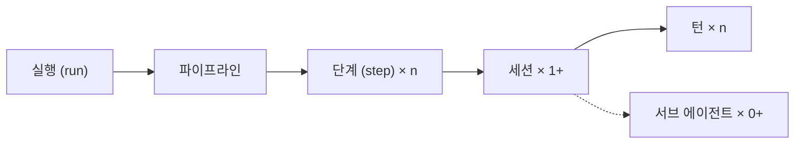

# BIVE 기획서

> **변환 정보**
> - 원본: Notion 「BIVE 기획서」 — https://app.notion.com/p/BIVE-3f707f0265f481e2b48ee063bc7668d6
> - 원본 최종 수정: 2026-10-15 · 변환: 2026-10-15
> - 변환 규칙: 내용 · 표현은 원문 그대로. 구조만 마크다운으로 정리. `미정` = 원문의 미확정 표기. 이미지로만 있던 정보는 "(이미지에서 옮김)"으로 표시
> - 관련 문서: [prd.md](./prd.md) (요구사항) · [screens.md](./screens.md) (화면 정의서)

---

## 1. 개요

### 1.1 한 줄 정의

> AI 에이전트가 작성한 코드를, 코드 대신 **규범(요구사항 · 규칙 · 계약)과 판정 결과**로 검증하는 로컬 개발 도구

- 이름: BIVE (Baseline-Integrated Verification Environment). 이전 이름 Plumo

### 1.2 핵심 원칙

| 원칙 | 내용 |
|---|---|
| **인지 병목 제거** | 사람이 코드를 직접 읽어야 하는 구간 최소화 |
| **빠른 검증** | 에이전트 작업 결과를 판정과 지표로 즉시 확인 |
| **명확한 지시** | 화면의 항목 단위로 지시. 지시는 규범 변경 제안으로 변환 |

### 1.3 목표

| ID | 목표 | 수단 |
|---|---|---|
| G1 | 에이전트 코드 검증의 병목 감소 | 판정, 준수 지표, 검증 화면 |
| G2 | 코드 · 설계에 대한 인지 부채 감소 (에이전트가 임의로 추가한 기획 파악) | 설계 탭, 규범 외 추가 카드, ADR |
| G3 | 규범과 코드의 일치 유지, 항목 단위 지시 | 지시 → 규범 변경 제안, 승인, 실행 |

### 1.4 성공 지표 `미정`

- 코드 직접 열람 횟수와 사유 기록
- 감소할수록 목표 근접. 사유는 화면 개선 근거
- 측정 시작: M1 직후 (확정, PRD 6장 · MET-01)

### 1.5 대상 사용자

| 구분 | 대상 |
|---|---|
| 1차 | AI 에이전트 코딩으로 웹(FE + BE + DB) 솔루션을 개발하는 개발자 (비개발자 제외) |
| 확장 | 앱 · 기타 아키텍처 `미정`, 비개발자 |

---

## 2. 제품 형태

- **로컬 설치형 데스크톱 프로그램.** 웹 서비스 아님, 별도 서버 없음
- 구성: 화면 앱(Electron), 백그라운드 프로세스(오케스트레이터, Node), 에이전트 프로세스(세션당 1개)의 3층. 화면 앱과 오케스트레이터는 로컬 파이프로 통신. 앱을 닫아도 실행 유지 (확정, PRD 5.1 · NFR-06)
- 지원 환경: Windows(네이티브) · macOS · Linux. Windows 최우선 (확정, PRD NFR-10)
- 지향점: 코드를 덜 보고 에이전트로 조회 · 제어하는 개발 환경(ADE)
- (실제 역사) 개발 도구 변천: 명령줄 도구 → 전용 IDE → 플러그인 기반 IDE → 경량 에디터 · 웹 IDE → **AI · 에이전트 기반 개발 환경 (ADE)**

### 2.1 프로젝트 연동

- IDE의 Open Folder 방식으로 프로젝트 연결
- 연결 시 프로젝트 폴더에 식별용 설정 파일 생성. 규범과 실행 상태는 프로젝트 폴더 밖 저장소에 보관 (확정, PRD NFR-01)

| 구분 | 내용 | 보관 위치 |
|---|---|---|
| 설정 · 규범 | 블록 선언, 요구사항, 규칙, 계약 | 프로젝트 폴더 밖 저장소 (확정). 역할 에이전트의 직접 접근 불가. 블록 선언 파일의 위치는 `미정` |
| 실행 상태 | 실행 로그, 검토 대기열, 비용 | 프로젝트 폴더 밖 저장소 (확정) |

---

## 3. 용어

### 3.1 규범

| 용어 | 정의 | 예 | 관계 |
|---|---|---|---|
| 요구사항 | 사용자가 원하는 것을 자연어로 적은 문장. 단독으로는 검사 불가할 수 있음 | 환불은 결제 후 7일 이내만 가능 | 자식 규칙 · 계약 n개. 상태 = 자식 판정의 종합 |
| 규칙 | 코드 동작에 대한 한 줄 약속 + 이를 확인하는 검사. 검사가 있어야 판정 가능. 대상 블록 1개 이상과 위험도(risk) 지정 (PRD NRM-09). **제목**(사람이 읽는 요약)과 **진술**(EARS, 판정용)을 함께 가짐 (PRD NRM-02) | 제목: 비회원은 선예매 기간에 예매 불가 / 진술: WHEN 결제 후 7일 초과 환불 요청 THE SYSTEM SHALL 요청 거절 (EARS) | 부모 요구사항 1개 (내장 구조 규칙만 0개, PRD NRM-02) |
| 계약 | 시스템 경계(클라이언트↔서버, 서버↔DB, 서비스↔서비스)를 오가는 데이터의 모양(필드 · 타입 · 형식)에 대한 약속 | OpenAPI, DB 스키마(prisma 등), AsyncAPI | 부모 요구사항 0~1개 |

- **규칙 종류**: 아키텍처 규칙 · 기술 제약 · 비즈니스 규칙
- **규칙 vs 계약**: 함수 본문이 지켜야 할 조건 vs 함수 시그니처(인자 · 반환 타입)
- **경계 기준** `미정`: 스키마 파일만으로 판정 가능하면 계약(필드 · 타입 · NOT NULL · enum), 여러 필드 · 상태가 필요하면 규칙

### 3.2 실행

| 용어 | 정의 | 관계 |
|---|---|---|
| 실행 (run) | 규칙 1개 이상을 대상으로 한 에이전트 작업 단위. ID · 대상 규칙 ID · 상태 · 비용 합계 보유 | 파이프라인 1개 |
| 파이프라인 | 실행이 거치는 고정 단계 순서 | 단계 n개 |
| 단계 (step) | 파이프라인의 한 구간. 담당 역할 · 종료 조건 고정 | 세션 1개 이상 |
| 세션(session) | 에이전트 1개가 대화 맥락 1개로 작업하는 단위. SDK `query()` 1회. 재시도 시 새 세션 | 턴 n개, 서브 에이전트 0개 이상 |
| 역할 | 세션의 담당 업무. 테스트 작성 · 구현 · 변이 주입. 역할별 접근 파일 · 도구 상이. 모든 역할에서 셸 도구 제외, 명령 실행은 BIVE가 제공하는 고정 도구로만 (확정, PRD NFR-02). 역할이 쓰는 문장(규칙 제목 · ADR · 변경 요약 등)의 표현은 **작성 규칙**(역할별 문장 지침)으로 조정. 표현만 조정하고 내용 · 판정 구조는 고정 (PRD NRM-10) | — |
| 턴(turn) | 모델 왕복 1회 (응답 → 도구 실행 → 응답). `maxTurns`의 단위 | — |
| 서브 에이전트 | 세션이 작업 일부를 맡기려고 띄운 하위 에이전트. 허용 여부 `미정` | — |

### 3.3 블록

| 용어 | 정의 |
|---|---|
| 블록 | 설정 파일 `blocks`에 선언한 코드 단위. 포함 경로(include) · 공개 API(public) · 허용 의존(dependsOn) · 위험도(risk) |
| 도메인 블록 | 업무 단위 블록. auth, payment 등 |
| 공유 블록 | 여러 블록이 함께 쓰는 블록. lib |
| 미분류 파일 | 어느 블록에도 속하지 않은 파일 |

- 경계는 코드에서 측정하지 않고 설정 파일에 **선언**
- 블록 선언에 DB 모델(테이블) 소속은 포함하지 않음. 따라서 ERD는 블록별 강조를 하지 않음 (PRD DSN-04)
- 최초 선언: 에이전트 제안 → 사람 승인 `미정`
- 경계가 애매한 모듈: 공유 블록 또는 미분류로 처리

### 3.4 판정

> **판정** = 특정 커밋의 코드가 승인된 규칙 · 구조 검사를 지키는지를 **검사 실행 결과**로 결정하는 것

| 항목 | 내용 |
|---|---|
| 입력 | 규칙 + 규칙에 붙은 검사 + 커밋 |
| 출력 | 판정 상태 + 실행 시각 + 커밋 |
| 근거 | 인수 테스트 · PBT · 계약 검사 · 정적 분석의 실행 결과(exit code, 실패 목록)만. 에이전트 보고 · LLM 의견 불인정 |
| 판정 대상 2가지 | ① 코드가 규칙을 지키는가 → 판정 상태 / ② 검사가 믿을 만한가(결함 주입 시 실패하는가) → 변이 상태 |
| 판정 제외 | 규칙 자체의 타당성(사람의 승인 영역), 규칙 없는 코드(미분류 파일 · 규범 외 추가로 표시) |
| 판정 가능 항목 | 검사가 붙고 승인된 규칙 + 구조 검사. 잠정 승인 규칙은 분리 집계 (PRD JDG-03) |
| 준수 | 통과 / 판정 가능 항목 |

#### 상태

| 구분 | 상태 | 의미 |
|---|---|---|
| 판정 | 통과 | 검사 전부 성공 |
| 판정 | 실패 | 검사 실패 |
| 판정 | 미판정 | 검사 없음 · 미실행 · 미승인 |
| 판정 | 격리 | 판정에서 일시 제외 (불안정한 검사 등) |
| 판정 | 재검증 필요 | 코드 또는 규칙 변경 후 미재실행 |
| 변이 | 변이 검증됨 | 주입한 결함을 테스트가 검출 |
| 변이 | 변이 미검증 | 변이 주입 미실시 |
| 변이 | 변이 생존 | 주입한 결함을 테스트가 미검출 |

#### 기타

- **구조 검사**: 블록 선언 준수 여부를 보는 내장 규칙. `structure.public-api-only`(공개 API로만 접근), `structure.declared-direction`(선언한 방향으로만 의존)
- **ADR** (Architecture Decision Record): 결정과 사유 기록

---

## 4. 기능

### 4.1 규범 관리

| 대상 | 생성 경로 | 비고 |
|---|---|---|
| 요구사항 | ① 사람 작성 · 지시 ② 에이전트 제안 → 잠정 승인 또는 사람 승인 ③ 기획 문서 수정 + 해시 변경 감지 (보류) | — |
| 규칙 | ① 요구사항에서 자동 생성 ② 사람 지시 ③ 에이전트 제안 → 잠정 승인 또는 사람 승인 | — |
| 계약 | 규칙과 동일 `미정` | 변경 시 계약 변경 승인 필수 |

- 모든 규범의 **생성 주체**(사람 · 에이전트) 기록
- **추적성 결함** 표시: 규칙 없는 요구사항, 요구사항과 연결되지 않은 규칙. 내장 구조 규칙과 '규칙화 불가' 요구사항은 제외 (PRD NRM-06 · NRM-08)
- **변경 이력**: 요구사항 · 규칙 상세에 기록. 파생 제안 · 코드 변경까지 사유와 함께 연결 `미정`

### 4.2 실행 파이프라인

| 단계 | 주체 | 종료 조건 |
|---|---|---|
| 승인 | 사람 (생략 불가. 자동 모드는 실행 시작 확인만 생략) | 대상 규범 승인 |
| 테스트 작성 | 테스트 작성 에이전트 | 대상 규칙별 인수 테스트 존재 |
| Red 확인 | 도구 | 테스트 전부 실패 (구현 전 통과하는 테스트 차단) |
| 구현 | 구현 에이전트 | 테스트 전부 통과 |
| 검사 | 도구 | 검사 실행 후 실패 없음. 실패 시 구현 단계로 회귀, 회귀 상한 2회 초과 시 실패 (PRD RUN-02). M1의 검사는 인수 테스트 전체 실행만, 구조 · 계약 검사와 정적 분석은 P1 |
| 변이 주입 | 변이 주입 에이전트 | 규칙별 주입 결과 기록 |
| 화면 갱신 | 도구 | — |

- **실행 대상**: 규칙 ID. 계약 대상이어도 해당 계약을 검사하는 규칙(`contract`)이 대상. 없으면 규칙 함께 제안
- **역할 분리**: 테스트 작성 · 구현 · 변이 주입 에이전트 분리. M1은 테스트 작성 · 구현 2개 (PRD RUN-04)
- **통과 판정 근거**: 테스트 실행기 결과(exit code, 실패 수). 에이전트 보고 불인정. 판정용 실행은 오케스트레이터가 BIVE 전용 러너 설정으로 직접 수행. 인수 테스트는 HTTP 등 공개 인터페이스로만 검사 (확정, PRD JDG-01)
- **실행 시작**: 사용자 승인 후 시작. 첫 승인 이후 자동 모드 설정 가능 (자동 모드는 실행 시작 확인만 생략, 규범 승인은 생략 불가)
- **검사 종류**: 테스트 · 속성 기반 테스트(PBT) · 계약 · 정적 분석 · 구조 검사
- **실행 유형** (PRD RUN-07): A 신규 동작은 전체 단계 / B 정적 검사 규칙은 테스트 작성 · Red 확인 생략 / C 코드 유지 · 테스트만(역추출 · 기존 코드 규칙 등록, 테스트 보강)은 Red 대신 Green 확인, 구현 생략. 테스트 보강이면 변이 재주입이 종료 조건 / D 리팩터링 · 되돌리기는 테스트 작성 · Red 확인 생략, 기존 검사 유지. 유형별 세부 종료 조건 `미정`
- **실행 브랜치 · 병합** (PRD RUN-08): 실행 1개 = 전용 브랜치 1개 + 프로젝트 폴더 밖 워크트리. 커밋은 오케스트레이터가 수행. 판정 통과 시 기준 브랜치에 자동 병합, 실패 · 예산 초과 시 브랜치 보존
- **끊김 복구** (PRD 5.1): 실행 상태는 단계 종료마다 저장. 비정상 종료 시 '중단'으로 표시, 사람이 재개하면 마지막 완료 단계 다음부터 시작
- **M1 범위** (PRD RUN-02 · 6장): 유형 A만, 변이 주입 제외, 검사는 인수 테스트 실행만. 대상 스택은 Next.js · Prisma · SQLite · Vitest

### 4.3 검증 지표

| 지표 | 정의 | 구분 |
|---|---|---|
| 준수 | 통과 / 판정 가능 항목 | 주 지표 |
| 변이 검증됨 | 결함을 검출한 테스트가 있는 규칙 수 | 주 지표 |
| 테스트 커버리지 | 실행된 줄 비율. 검증된 동작을 의미하지 않음 | 보조 `미정` |

### 4.4 지시와 승인

#### 능동 지시 (사용자 → 에이전트)

- 기획 탭: 요구사항 · 규칙 추가 · 변경 · 삭제 지시
- 설계 탭: 항목 클릭 후 지시 (예: L0 DB를 MySQL에서 Oracle로)
- **처리 흐름**: 지시 → 요구사항 · 계약 변경 제안 + ADR → 할 일에서 승인 → 대상 규칙으로 실행
- **질문과 지시의 구분** (PRD DSN-07 · DSN-08): 항목을 참조한 뒤 사용자가 질문 또는 지시를 명시적으로 선택. 질문은 답변만(규범 · 코드 변경 없음, 답변 근거는 화면 사실만), 지시만 규범 변경 제안으로 변환
- 이유: 코드 직접 수정 시 규범과 코드 불일치(드리프트) 발생

#### 수동 응답 (에이전트 제안 → 사용자)

- 에이전트 제안(요구사항 · 규칙 · 설계의 추가 · 변경 · 삭제) 승인 또는 거절. 승인 시 제안 문장을 고친 뒤 승인 가능 (확정, PRD NRM-04)
- **잠정 승인**: 사람 승인 전 우선 진행 (병목 방지)
  - 할 일에 잔류, 거절 시 되돌리는 실행 생성 `미정`
  - 준수 지표에서 별도 표시 `미정`
  - 고위험 블록(`risk: high`) 제외 `미정`
- **사유**: 거절 사유 필수 (확정, PRD NRM-04). 이의 제기 · 격리는 필수, 승인은 선택 `미정`

#### 연동

- Claude Agent SDK로 화면의 명령을 에이전트에 전달

### 4.5 비용

| 항목 | 내용 |
|---|---|
| 출처 | SDK 결과 메시지 · `total_cost_usd`: 세션 누적 추정 비용. 마지막 값 사용 · `modelUsage`: 모델별 토큰 · `costUSD`. 서브 에이전트 포함 · `num_turns`: 턴 수 |
| 계산 | Σ 모델별 (입력 × 입력 단가 + 출력 × 출력 단가 + 캐시 읽기 × 읽기 단가 + 캐시 쓰기 × 쓰기 단가) ÷ 1,000,000 |
| 집계 | 세션 → 단계 → 역할 → 실행. 값 없으면 0이 아닌 '없음' 표시 |
| 한도 | 실행 전체 · 역할별 `maxBudgetUsd`, `maxTurns`. 초과 시 SDK가 `error_max_budget_usd`로 중단 → 예산 초과 → 검토 대기열 |
| 정확도 | 추정치(청구액 아님). 구독: 사용량 환산값. API 키: 실제 청구액은 콘솔에서 사후 확인 (실행 단위 구분 불가) |

- **비용 결정 요인** (실측, Plumb `docs/harness-notes.md`)
  - 컨텍스트 크기: 같은 2턴 호출이 $0.011 vs $0.515. MCP 도구 유입으로 캐시 쓰기 약 12만 토큰
  - 모델: 같은 토큰에 약 4배 차이 → 역할별 모델 명시
- 첫 턴 캐시 쓰기 토큰 동시 표시 `미정`
- 실행 전 예상 비용: 과거 실행의 역할 · 규칙 종류별 중앙값 `미정`. 정의 전까지 화면 미표시 (추정 공식 금지, PRD NFR-03)

---

## 5. 사용 흐름

### 5.1 새 프로젝트

1. BIVE 실행 → 빈 폴더 선택
2. 요구사항 작성 → 필요한 실행 생성
3. 사용자 승인 후 실행 시작. 첫 승인 이후 자동 모드 설정 가능

### 5.2 기존 프로젝트

1. 기존 프로젝트 폴더 선택
2. **[BIVE 동기화]** → 설계 메타 파일 생성
3. 초기 상태: 요구사항 · 규칙 · 계약 없음
4. 요구사항 생성
   - 직접 작성
   - **[요구사항 자동 생성]**: 코드 분석 → 요구사항 · 규칙 · 계약 역추출 → 제안. 사람 승인 필수

---

## 6. 시스템 구성

**시스템 구성도 (이미지에서 옮김)**

| 구성 요소 | 설명 (상자 안 문구) | 내부 구성 (상자 안 작은 상자) |
|---|---|---|
| 화면 앱 | Electron · 승인과 화면 표시 | — |
| 백그라운드 프로세스 (오케스트레이터) | Node · 앱을 닫아도 유지 | 실행 관리 (단계 · 예산 · 커밋) · 판정기 (테스트 직접 실행) · 고정 도구 (허용된 명령만) · 파서 · 감시자 (구조 · 변경 감지) |
| 에이전트 프로세스 (점선 상자) | 세션당 1개 · 셸 없음 | 테스트 작성 · 구현 · 변이 주입 (P1) |
| 실행 워크트리 | 프로젝트 코드 · 실행별 브랜치 | — |
| 폴더 밖 저장소 | 규범 · 승인 기록 (상자 아래 문구: 에이전트는 접근 불가) | — |

연결선 (이미지에서 옮김):

| 출발 | 도착 | 선 라벨 |
|---|---|---|
| 화면 앱 | 백그라운드 프로세스 (오케스트레이터) | 로컬 파이프 |
| 백그라운드 프로세스 (오케스트레이터) | 에이전트 프로세스 | SDK로 세션 실행 |
| 백그라운드 프로세스 (오케스트레이터) | 폴더 밖 저장소 | (라벨 없음) |
| 에이전트 프로세스 | 실행 워크트리 | 파일 읽기 · 쓰기 |

> 화면 데이터는 **파서 · 실행 결과에서만** 생성. 목 데이터 · 근거를 물리적으로 찾을 수 없는 값 금지. 수집이 필요한 값(호출 커버리지 · 테스트 요청 경로 · 계약 매핑 · 변경량 기준선)은 PRD 4.9 수집 이후 표시

| 구성 요소 | 역할 |
|---|---|
| 파서 | import 그래프, 블록 판정, 스키마 → ERD, 코드 중복 측정, 테스트 요청 경로 스캔 · OpenAPI 경로 대조 (PRD COL-02 · COL-03) |
| 오케스트레이터 | 실행 · 역할 관리, 예산 집계, 커밋 · 병합, 고정 도구 제공. 화면 앱과 분리된 백그라운드 프로세스 (Node, Claude Agent SDK) |
| 판정기 | 검사 실행(BIVE 전용 러너 설정), 변이 주입, 인수 테스트 호출 커버리지 수집 (PRD COL-01) |
| 저장소 | 규범, 대기열, 로그. 프로젝트 폴더 밖에 보관 |
| 감시자 | 파일 · 해시 변경 감지. 백그라운드 프로세스가 꺼져 있던 동안의 변경은 다음 기동 시 커밋 비교로 감지 |
| 화면 앱 | Electron. 오케스트레이터와 로컬 파이프로 통신. 승인은 이 경로로만 전달 |

---

## 7. 검토 중

### 7.1 API · SQL · 부하 테스트

| 대상 | 처리 방식 |
|---|---|
| API 테스트 | 계약 테스트 + 엔드포인트 커버리지 |
| SQL 테스트 | 데이터 모델 계약 (스키마 불일치) |
| 부하 테스트 | 성능 규칙 (예: p95 지연 한도). 결과 변동이 커 후순위 |

- 방향: Postman류 도구 직접 구현 대신, 에이전트가 규칙의 검사로 작성하고 BIVE는 판정 · 표시 `미정`

---

## 8. 미결 사항

| # | 항목 | 현재 안 | 쟁점 (v5 대비) |
|---|---|---|---|
| 1 | 규범 파일 저장 위치 | **확정**: 프로젝트 폴더 밖 저장소 (PRD NFR-01) | 종결. 남은 쟁점: 블록 선언 파일의 위치(프로젝트 폴더 안 설정 파일 / 폴더 밖 저장소) |
| 2 | 요구사항 출처 | 사람 작성 + 에이전트 제안(잠정 승인) | v5: 개발자만 작성. 기획 문서 임포트가 주 경로 |
| 3 | 잠정 승인 범위 | 고위험 블록 제외 | v5: 방향 × 위험 2축. 완화 · 삭제 · 경계 변경 + 고위험만 사전 승인 |
| 4 | 테스트 커버리지 | 보조 지표 | v5: 지표 제외 (결함 검출력과 상관 약함) |
| 5 | 서브 에이전트 | 단계당 0개 이상 | v5: 역할 에이전트의 생성 금지 (격리 누수) |
| 6 | 설계 화면 범위 | 서버 · 클라이언트 모두 | v5: UI 화면은 대상 아님 (Playwright 인수 테스트로 확인) |
| 7 | 블록 레벨 | L0 · L1 | v5: L2 유닛(엔드포인트 · 엔티티 = 지시 단위) 포함 |
| 8 | 단계별 비용 표시 위치 | 실행 추적(단계 · 세션) + 검증 화면 규칙 목록(실행 합계) | 결정 (화면 정의서 v0.5) |
| 9 | v5 핵심 장치 반영 | 일부 반영: 폴더 밖 저장소, 역할 접근 제한(셸 없는 설계), 판정용 실행의 직접 수행 | 인수 · 단위 테스트 구분, 역할 격리 방식, 검사 범위 밖 표시, 차이 탐색, 이의 제기, 자유 모드, 병합 게이트. (흐름도 실선 · 점선은 PRD COL-01로 반영) |
| 10 | 이름 | **확정**: BIVE (Baseline-Integrated Verification Environment). 이전 이름 Plumo | 기존 저장소 · CLI · 설정 파일명은 Plumb |
